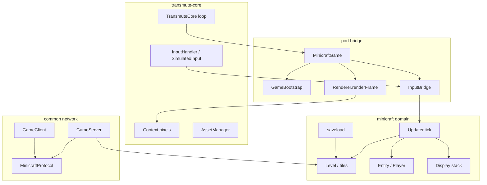

# Architecture

Minicraft keeps the adapted Minicraft+ **game domain** and runs it on a **transmute-core platform** layer. Transmute owns the window, fixed timestep loop, pixel buffer, assets bootstrap, and headless harness. Minicraft owns tiles, entities, items, menus, saves, and (via `:common`) LAN multiplayer.



## Modules

| Gradle module | Responsibility |
|---------------|----------------|
| `:client` | `MinicraftGame`, UI, rendering bridge, SP domain |
| `:common` | Wire protocol, `GameServer`, `GameClient` |
| `:server` | Dedicated process entry (`MinicraftServerMain`) |

## Frame path

```mermaid
sequenceDiagram
  participant Loop as TransmuteCore
  participant Game as MinicraftGame
  participant Bridge as InputBridge
  participant Updater as Updater
  participant Renderer as Renderer
  participant Ctx as Context
  Loop->>Game: update(delta)
  Game->>Bridge: syncFromTransmute
  Bridge->>Updater: inject keys + tick input
  Game->>Updater: tick (fixed 60 Hz)
  Loop->>Game: render
  Game->>Renderer: renderFrame
  Renderer-->>Game: INT_RGB buffer
  Game->>Ctx: copy ARGB pixels
```

## Design rules

- Do **not** force Minicraft `Level` / rich tiles into transmute `World` (empty/solid only).
- Prefer adapting menus via the existing `Display` queue before rewriting onto `StateManager`.
- Headless CI uses `GameHarness` + `SimulatedInput`; `Updater` treats transmute mode as focused so gameplay ticks without an AWT canvas.
