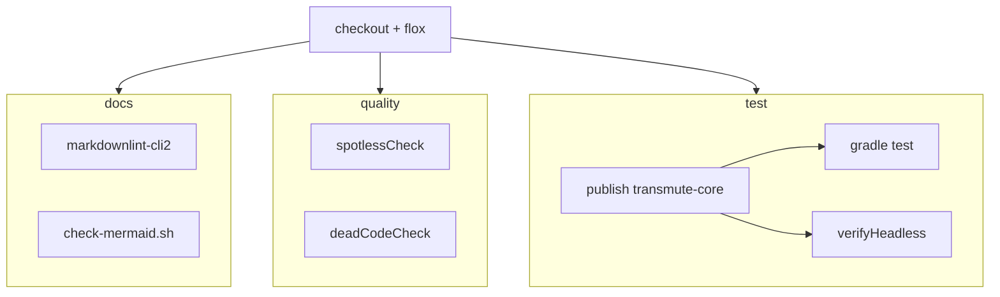

# CI

GitHub Actions workflow: [`.github/workflows/ci.yml`](../.github/workflows/ci.yml).

Runs on Blacksmith Ubuntu runners. Jobs are split so docs failures do not hide Java failures. Every job enters the [Flox](https://flox.dev/) environment so CI matches local tooling.



## Jobs

| Job | What |
|-----|------|
| `docs` | `markdownlint-cli2` + `scripts/check-mermaid.sh` (syntax always; `mmdc` render when Chromium is on `PATH`) |
| `quality` | Spotless + dead-code checks inside Flox |
| `test` | Publish Java transmute-core (`:transmute-core`) to mavenLocal, then Gradle tests + headless smoke inside Flox |

## Mermaid validation

`scripts/check-mermaid.sh`:

1. **Syntax** — extracts `mermaid` fenced blocks from `README.md`, `AGENTS.md`, and `docs/**/*.md`; checks diagram type and balanced brackets.
2. **Render** (optional) — if Chromium/`google-chrome` and `mmdc` are available, renders each diagram to SVG. CI installs Chromium so this path runs on Linux; macOS Flox skips render when Chrome is absent.

## Local parity

```bash
flox activate -- bash -lc 'markdownlint-cli2 && ./scripts/check-mermaid.sh'
flox activate -- ./gradlew spotlessCheck deadCodeCheck
flox activate -- ./gradlew test :client:verifyHeadless
```

Or use aliases after `flox activate`: `mc-docs`, `mc-test`.
