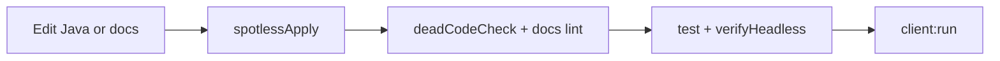

# Development

## Flox

All tooling is expected to run inside Flox:

```bash
flox activate
flox activate -- ./gradlew spotlessCheck
```

Packages: Temurin 17, Git, GitHub CLI, pre-commit, markdownlint-cli2, mermaid-cli.

Aliases (interactive activate): `mc-run`, `mc-test`, `mc-fmt`, `mc-docs`, `mc-server`.

## Format

Spotless + google-java-format:

```bash
./gradlew spotlessApply
./gradlew spotlessCheck
```

Pre-commit (installed on Flox activate when missing):

```bash
pre-commit install
pre-commit run --all-files
```

## Dead code gates

```bash
./gradlew deadCodeCheck
```

- PMD unused-code on Transmute-authored packages
- Empty top-level type stub scan (`scripts/check-empty-types.sh`)

## Docs quality

```bash
markdownlint-cli2          # globs from .markdownlint-cli2.jsonc
./scripts/check-mermaid.sh # syntax always; render if Chromium present
# or: mc-docs
```

## Typical loop



## Agent notes

See root [`AGENTS.md`](../AGENTS.md) for the golden path used by automation.
