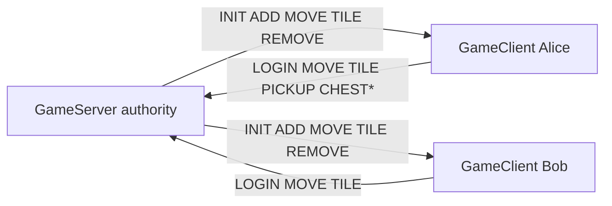

# Multiplayer

LAN multiplayer uses a null-delimited packet stream adapted from Minicraft+ Online framing (`MinicraftProtocol` in `:common`). The dedicated process is `:server`; the same `GameServer` can be driven from tests in-process.

> Legacy account-login servers are **not** supported. Wire compatibility with upstream Minicraft+ Online is not promised.

## Roles



## Session flow

```mermaid
sequenceDiagram
  participant C as GameClient
  participant S as GameServer
  C->>S: LOGIN name
  S-->>C: INIT id;x;y
  S-->>C: TILE snapshots
  C->>S: MOVE x;y
  S-->>C: MOVE id;x;y
  C->>S: TILE tx;ty
  S-->>C: TILE tx;ty;0
  C->>S: PICKUP / CHESTIN / CHESTOUT
  C->>S: DISCONNECT
  S-->>C: REMOVE id
```

## Run

```bash
# terminal 1
./gradlew :server:run --args='--port 4225'

# terminal 2 — game client (UI join wiring continues to evolve)
./gradlew :client:run
```

Integration coverage lives in `:common` (`MultiplayerIntegrationTest`): join, move, dig, pickup, chest, disconnect.
