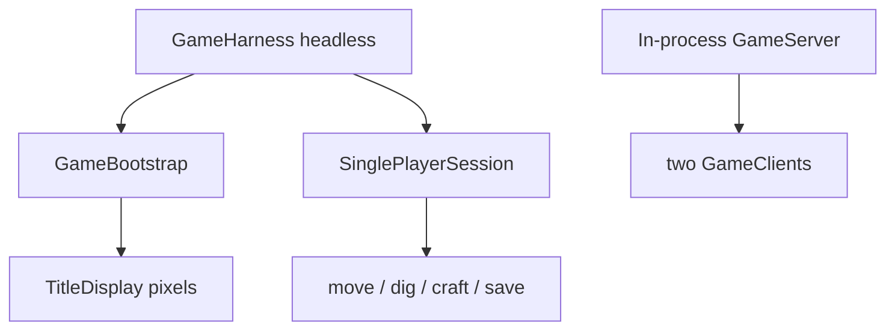

# Testing

## Headless smoke

```bash
./gradlew :client:verifyHeadless
```

Boots `MinicraftGame` under `GameHarness`, steps frames, asserts the title screen painted non-black pixels.

## Singleplayer playtest

```bash
./gradlew :client:test --tests games.transmute.minicraft.SinglePlayerPlaytest
```

Covers world gen → move → attack → dig → craft → save/load via `SinglePlayerSession` helpers.

## Domain smoke

```bash
./gradlew :client:test --tests games.transmute.minicraft.DomainFidelitySmokeTest
```

## Multiplayer

```bash
./gradlew :common:test --tests minicraft.network.MultiplayerIntegrationTest
```

## Full gate (local)

```bash
./gradlew spotlessCheck deadCodeCheck test :client:verifyHeadless
markdownlint-cli2
./scripts/check-mermaid.sh
```


